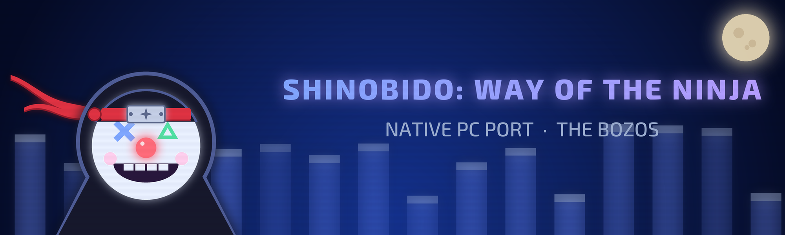
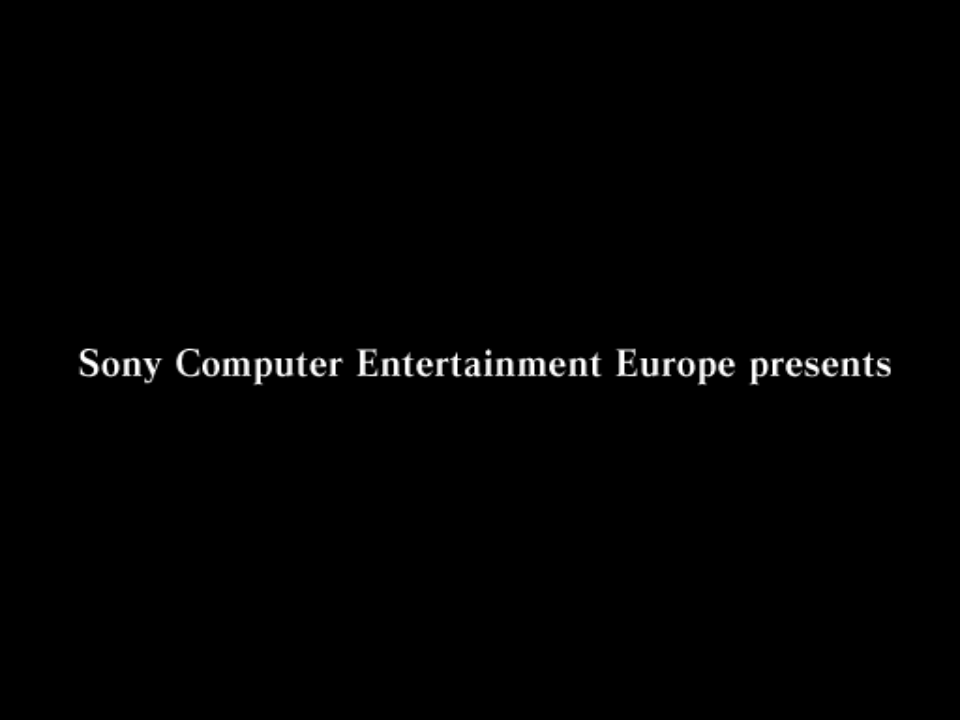
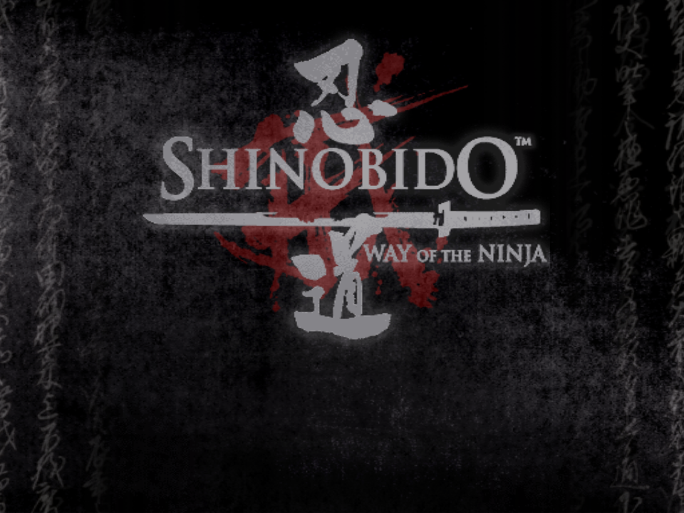
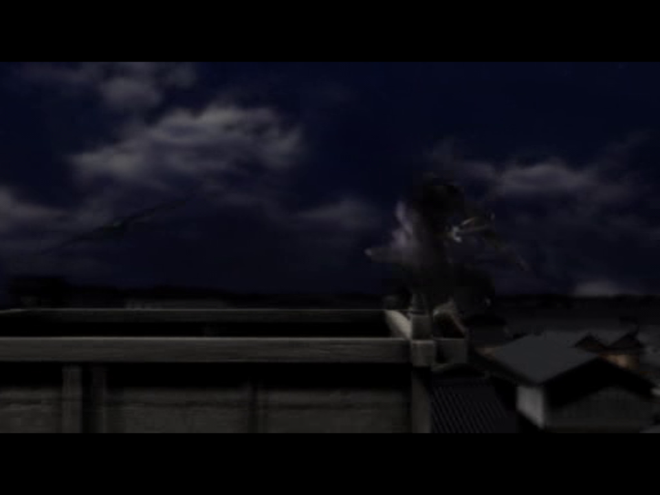
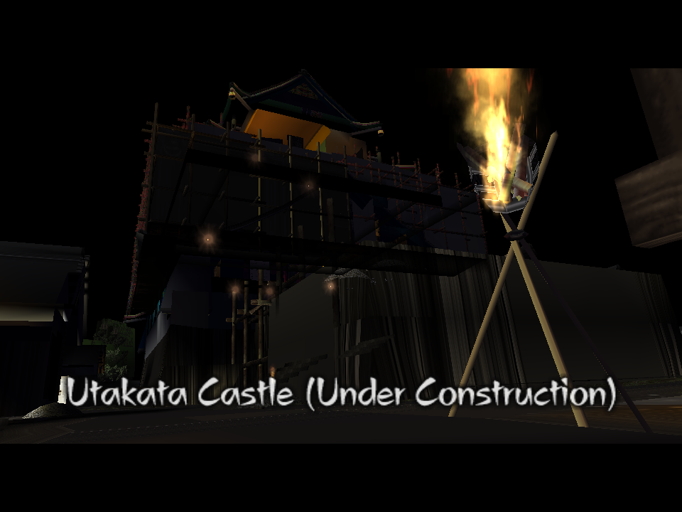

<div align="center">

# Shinobido_WOTN_Recomp

**A native PC port of *Shinobido: Way of the Ninja* (PAL, `SCES-53931`), made by statically recompiling the game's PlayStation 2 code to C++. Windows first; Linux and macOS later.**<br>
Built on [BozoEngine](https://github.com/TheBozos/BozoEngine), The Bozos' own toolchain: the game's EE code recompiled to C++, every library and kernel call it makes answered by native code. No PS2 hardware model at any level: no GS, VU, VIF/GIF, DMA, IOP or SPU2.

-1b8cff)


</div>

> [!IMPORTANT]
> No game files are included: no ELF, IRX modules, data archives, or code generated from them.
> You need **your own copy** of the European release, PS2 ID **`SCES-53931`** (disc version 1.00, English, French,
> German, Spanish and Italian). The port is built against that disc's executable:
>
> | File | SHA-1 |
> |---|---|
> | `SCES_539.31` | `dbadec418726d0049c4311ef6fa97204cf6fe3f8` |

## Status

**The game reaches 3D gameplay natively (2026-11-23).** From "New Game" it plays the opening in-engine cutscene at
Utakata Castle, then hands over control: the ninja walks the castle grounds with his HUD (health, the detection eye, the
compass), the tutorial messages and the pause menu. Before that, it boots at full speed through "Sony Computer
Entertainment Europe presents" and the memory card check to the title screen. Everything on screen is drawn from the
game's own data:
- the game's render scheduler is replaced natively;
- its VU1 microprograms (its 2D and 3D both run through them) and the 3D's VU0 microprograms are executed by the port;
- the GS packets they send become native draws, with the textures decoded from the game's own uploads.

The sound modules (Sony's LIBSD and SDRDRV, Acquire's TORAST and TORASE) are statically compiled, and the title plays
its music.

**The movies play with their sound** (the Acquire logo and the intro before the title): decoded natively, their
audio fed through the game's own player to the IOP. The game runs at the PAL rate, 50 frames a second.

In progress:
- **3D drawing**: some surfaces show the wrong texture (bright stripes, flat colours), and gameplay runs at about 20 to
  25 frames a second instead of 50.
- **Sound in play**: sound effects and voices are not checked yet.

[docs/RECOMP_NOTES.md](docs/RECOMP_NOTES.md) has every boot step, how the drawing works and what is next.

## Screenshots

| | |
|---|---|
|  |  |
| The boot's first screen, drawn by the game's VU1 text program | The title: its logo and background, from the game's own textures |
|  |  |
| The intro movie, decoded natively | The intro movie: the rooftops at night |
|  |  |
| The main menu ("New Game", on fresh memory cards) | The opening in-engine cutscene at Utakata Castle |
|  | |
| Gameplay: the ninja in the castle grounds, with his HUD (some textures still wrong) | |

## Goal

A fully playable *Shinobido: Way of the Ninja* as a native executable on Windows, Linux and macOS, from the intro to
the end of the story. Accuracy first: the console's picture by default, the PC's options (widescreen, resolution,
anti-aliasing, frame rate) on top, each off or as the console unless chosen.

## How it works

```
disc (your ISO) ──► scripts/extract_iso.sh ──► game/ (SCES_539.31, IOP/MODULES/*.IRX, VOLUME.DAT, SOUND/*.TRS)
                                   │
            tools/shino_prepare.py ──► build/bozo/shino_prep/shino.elf (its code sections described)
                                   │
 recomp/shino_symbols.txt (names for the stripped ELF: scripts/symbols.sh) + runtime/ overrides
                                   │
        bozo-externals ──► the externals list   bozo-recomp ──► C++ (build/bozo/shino_gen/)
                                   │
              CMakeLists.txt ──► BozoEngine runtime + generated code + runtime/ ──► shinobido (window), shino-headless
```

- The retail executable is stripped. `recomp/shino_symbols.txt` names its library and kernel functions:
  BozoEngine's `bozo_symbolmap.py` matches them against executables that keep their symbols (Dark Cloud's, Twisted
  Metal: Black's and Onimusha: Warlords'), and `recomp/shino_symbols_reviewed.txt` adds the ones read from the code,
  each with its evidence. Every named function BozoEngine knows is answered natively.
- `tools/shino_prepare.py` describes the executable's code to bozo-recomp: its one section mixes code, VU microcode
  and data, so the code (`0x100000-0x4f1500`) and the C++ static constructors the linker left among the data
  (`0x614b80-0x617484`) are given as the code sections.
- `runtime/shino_port.cpp` registers the port's overrides by address and its native instruction sites;
  `runtime/shino_main.cpp` is the headless runner and the window.
- Drawing (bring-up path): `runtime/shino_render.cpp` answers the game's render scheduler and its vblank flip;
  `runtime/shino_vu1.cpp` runs the VIF1 stream and the game's VU1 microprograms; `runtime/shino_gs.cpp` and
  `runtime/shino_gs_state.cpp` turn their GS packets into native draws and decode the textures from the game's
  uploads. To be replaced by native draws at the game's own functions, as the other ports do.
- Sound: `tools/shino_bozo_audio.py` compiles the IOP sound modules from the disc (BozoEngine's `tools/native_irx`),
  `runtime/shino_audio.cpp` runs them. Movies: BozoEngine's native libmpeg with a minimal static FFmpeg
  (`scripts/build_ffmpeg.sh`).
- Nothing derived from the disc is committed: the generated code is in `build/`.

## Requirements

- Windows 10/11 with [MSYS2](https://www.msys2.org/) (UCRT64); Linux and macOS are the goal, not built yet
- CMake 3.21+, Ninja, GCC 13+ or Clang with C++20
- GNU make and curl (the movies' minimal FFmpeg is built from its source once: scripts/build_ffmpeg.sh)
- `bsdtar` (libarchive) to extract the disc, Python 3
- To regenerate the symbol map: reference executables that keep their symbols (scripts/symbols.sh)
- A CPU with AVX2 (the runtime is built for `x86-64-v3`)
- Your own copy of `SCES-53931` (check the hash above)

## Build and run

```bash
git clone --recurse-submodules https://github.com/TheBozos/Shinobido_WOTN_Recomp.git
cd Shinobido_WOTN_Recomp
scripts/extract_iso.sh "/path/to/Shinobido - Way of the Ninja (Europe) (En,Fr,De,Es,It).iso"   # disc files -> game/
scripts/build_runtime.sh                       # recompile + runtime -> build/bozo
scripts/run.sh --frames 600                    # shino-headless: runs and reports what is not native yet
```

`build/bozo/shinobido.exe` is the window build. It reads the disc image at the repository's root under its No-Intro
name (`Shinobido - Way of the Ninja (Europe) (En,Fr,De,Es,It).iso`); give another place with `--iso FILE` or
configure with `-DSHINO_ISO=FILE`. `scripts/build_runtime.sh -DSHINO_WINDOW=OFF` builds the headless runner alone.

Save states: F5 saves, F7 loads, F6 / Shift+F6 pick the slot (0-9). From the command line:
`--save-state FILE --save-state-at N` and `--load-state FILE`.

### Windows

The same scripts run in an MSYS2 **UCRT64** shell, with MSYS2's GCC (MSVC is not supported for this port).

```bash
pacman -S --needed mingw-w64-ucrt-x86_64-{gcc,cmake,ninja,pkgconf,libarchive,python} make git
```

## Disc facts

- `SYSTEM.CNF`: `BOOT2 = cdrom0:\SCES_539.31;1`, `VER = 1.00`, `VMODE = PAL`.
- One stripped executable (5.4 MB, entry `0x100008`, image `0x100000-0x67c280`), built on Sony's SDK 3.0
  (`PsIIlibkernl 3000`, `libmc 3030`, `libpad 3020`).
- The game's data is in `VOLUME.DAT` (547 MB); music, ambience and voices in `SOUND/*.TRS`; movies are PSS
  (`PAL/COMMON`, and per voice language `PAL/MVE` English, `PAL/MVJ` Japanese).
- IOP: `IOPRP300.IMG`, Sony's pad, memory card and sound libraries, and Acquire's sound driver (`TORAST.IRX`,
  `TORASE.IRX`). [docs/RECOMP_NOTES.md](docs/RECOMP_NOTES.md) has the details.

## Repository layout

| Path | What |
|---|---|
| `BozoEngine/` | the engine (submodule, pinned) |
| `runtime/` | the port: overrides, native sites, the runner and the window (`app/`: icon, manifest, version) |
| `recomp/` | the symbol map of the stripped ELF and the names read by hand |
| `tools/` | the ELF's preparation, the overrides list, the RPC pairing, a disassembler with the map's names |
| `scripts/` | extract, symbols, build, run |
| `docs/` | recompilation notes, branding (`docs/branding/make_logo.py`) |

## Credits

The Bozos (boubou666, Arzaroth). The logo is The Bozos' clown as a ninja, drawn by `docs/branding/make_logo.py` on
BozoEngine's logo tool: generic shapes only, no game art.

## Legal

This project contains no code or data from the game. You must own the game to use it. *Shinobido: Way of the Ninja*
is a trademark of its respective owners; this project is not affiliated with or endorsed by them. MIT licence, see
[LICENSE](LICENSE).
