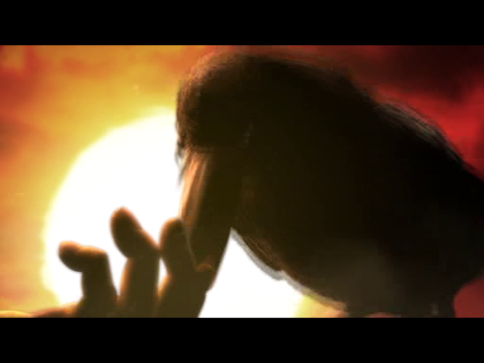
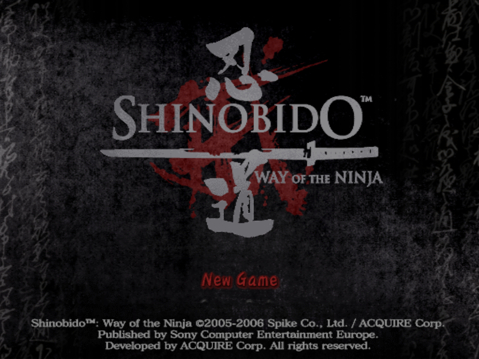
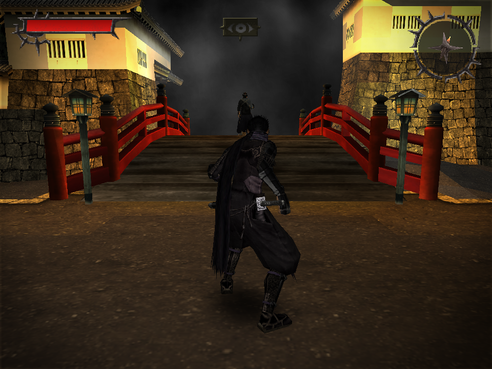
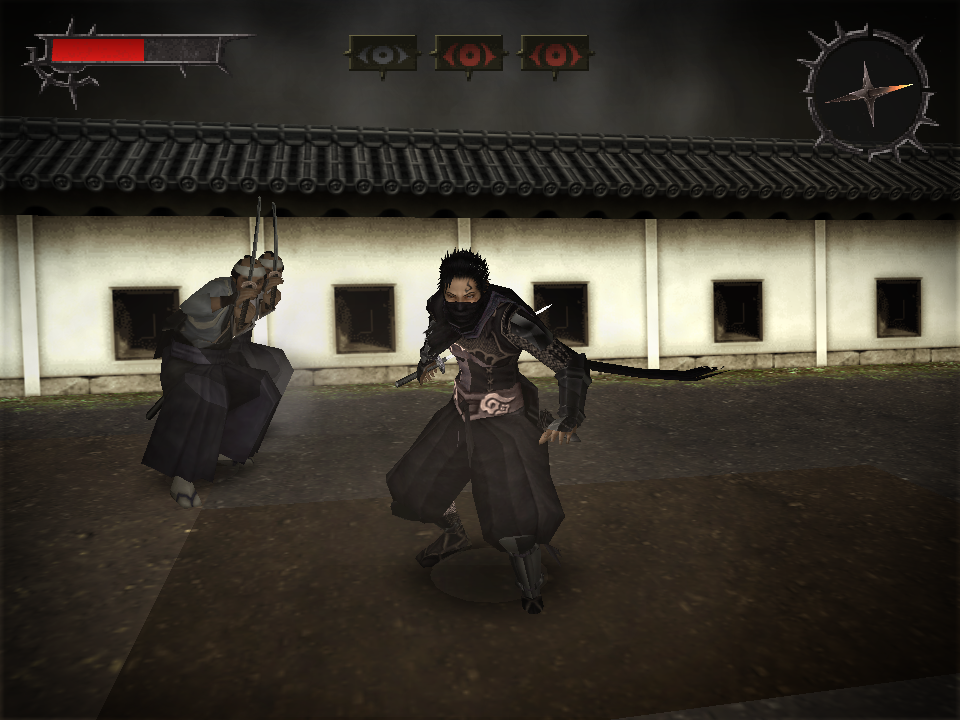
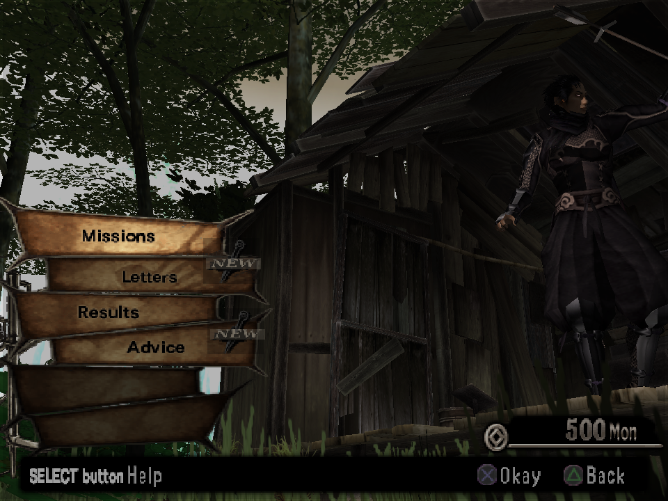
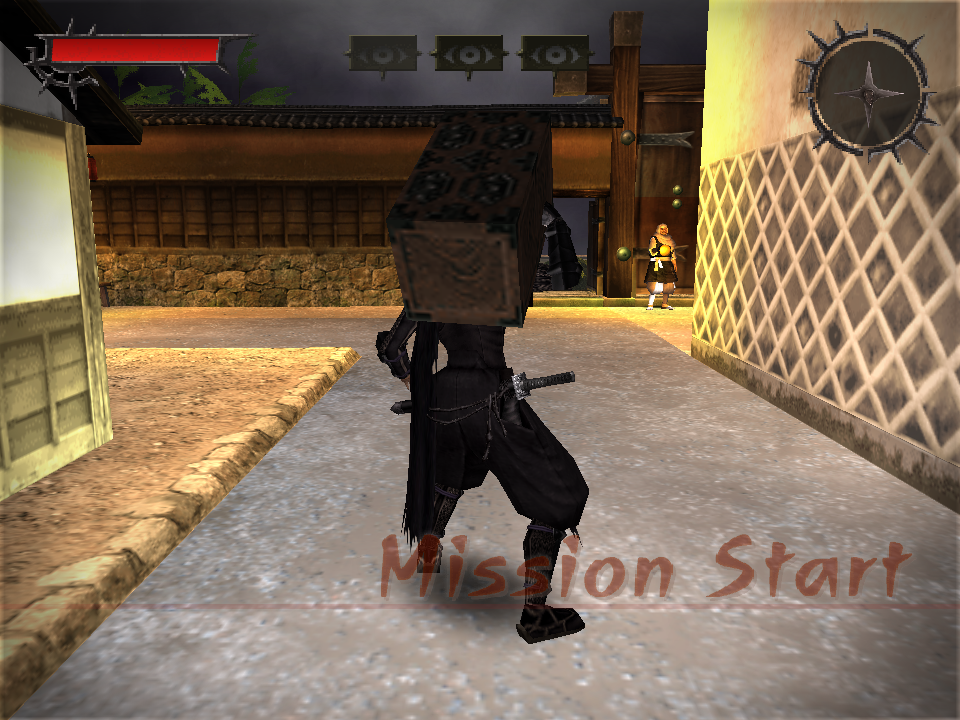
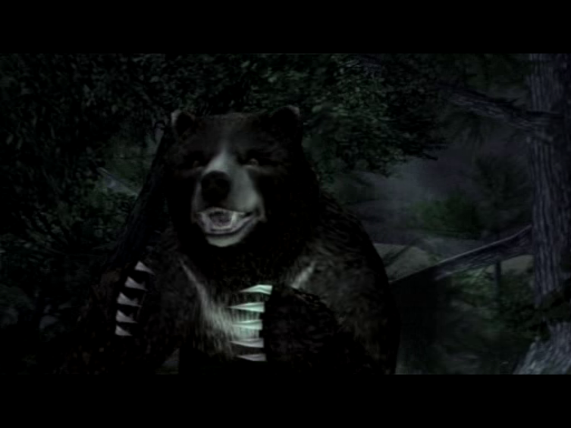
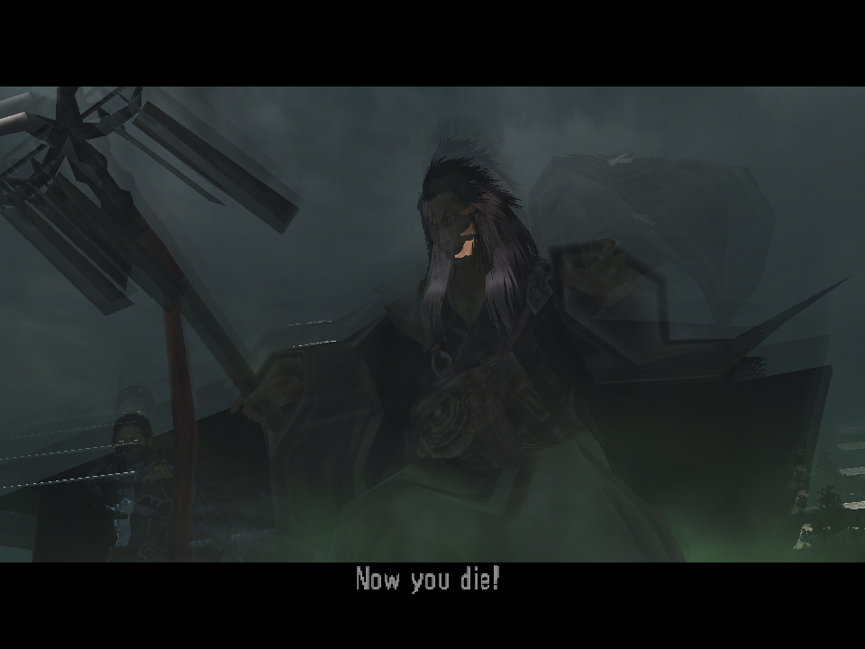
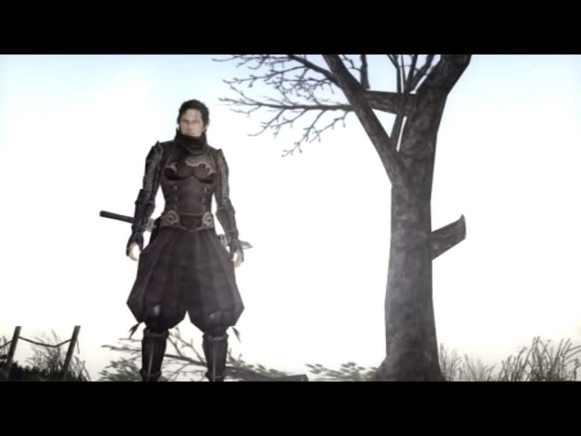
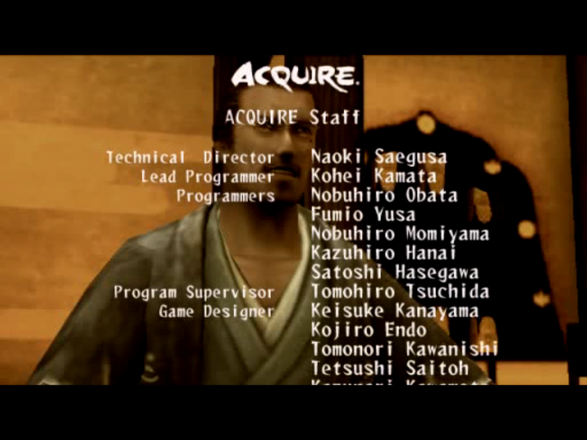

<div align="center">

# Shinobido_WOTN_Recomp

**A native PC port of *Shinobido: Way of the Ninja* (PAL, `SCES-53931`), made by statically recompiling the game's PlayStation 2 code to C++. Windows first; Linux and macOS later.**<br>
Built on [BozoEngine](https://github.com/TheBozos/BozoEngine), The Bozos' own toolchain: the game's EE code recompiled to C++, every library and kernel call it makes answered by native code. No PS2 hardware model at any level: no GS, VU, VIF/GIF, DMA, IOP or SPU2.

-1b8cff)


</div>

> [!IMPORTANT]
> No game files are included: no ELF, IRX modules, data archives, or code generated from them.
> You need **your own copy** of the European release, PS2 ID **`SCES-53931`** (disc version 1.00, English, French,
> German, Spanish and Italian). The port is built against that disc's executable:
>
> | File | SHA-1 |
> |---|---|
> | `SCES_539.31` | `dbadec418726d0049c4311ef6fa97204cf6fe3f8` |

## Status

**The game plays from boot to its ending (2026-11-26).** The whole story was played on the port, serving Lord Ichijo:
all eight soul fragments, the rival ninja (Kabuto, the Mosu twins, the Kenobi duo), Goh's turn as a bear, the end of
the war and the final fight with Gamuran, then the ending, Goh and Kinu's epilogue and the staff credits. Every
mission, scene, movie and boss fight on the way ran without a port fault. The run used the port's cheats and play
drivers (infinite health, one-hit kills, teleports, a script that plays each day in the Hideout), so it shows that the
game works end to end, not that it was played by hand; [docs/RECOMP_NOTES.md](docs/RECOMP_NOTES.md) ("The ending") has
the route.

What runs natively:
- the boot, from "Sony Computer Entertainment Europe presents" and the memory card check to the title screen;
- the movies (the Acquire logo, the intro, the story's movies), decoded natively with their sound;
- the game's render scheduler, its VU1 microprograms (its 2D and 3D both run through them) recompiled to C++ from the
  player's executable at build time, the 3D's VU0 microprograms interpreted;
- the GS packets they send, as native draws with the GS's depth test, the textures decoded from the game's own uploads;
- the sound modules (Sony's LIBSD and SDRDRV, Acquire's TORAST and TORASE), statically compiled: the music and the
  sound effects play;
- memory card saves, and save states that keep the sound.

The game runs at full speed: 25 frames a second, as on a PAL console (it draws a frame every second field).

The movies play at their own 25 pictures a second with their sound, and a listen through the boot, the intro, the
story's movies, the castle's cutscene and play found nothing wrong (2026-11-27). The busiest fight measured holds more
than twice the speed the game needs.

Next:
- **3D drawn natively** at the game's model functions, for higher resolutions and widescreen.
- **Speed** for slower PCs: the compiled VU1 code is the largest part of a busy frame.

[docs/RECOMP_NOTES.md](docs/RECOMP_NOTES.md) has every boot step, how the drawing works and what is next.

## Screenshots

| | |
|---|---|
|  |  |
| The boot's first screen, drawn by the game's VU1 text program | The title: its logo and background, from the game's own textures |
|  |  |
| The intro movie, decoded natively | The intro movie: the rooftops at night |
|  |  |
| The main menu ("New Game", on fresh memory cards) | The opening in-engine cutscene at Utakata Castle |
|  |  |
| Gameplay: the ninja in the castle grounds, with his HUD | Combat: a guard has spotted him (the detection eyes) |
|  |  |
| The Hideout after the first mission: the Mission Scroll menu | The second mission begins: a town, the letter's box on his back |
|  |  |
| "The killer whale's eye": Goh's soul put into a bear | The final enemy: Gamuran |
|  |  |
| The ending: Goh after the last fight | The staff credits |

## Goal

A fully playable *Shinobido: Way of the Ninja* as a native executable on Windows, Linux and macOS, from the intro to
the end of the story. Accuracy first: the console's picture by default, the PC's options (widescreen, resolution,
anti-aliasing, frame rate) on top, each off or as the console unless chosen.

## How it works

```
disc (your ISO) ──► scripts/extract_iso.sh ──► game/ (SCES_539.31, IOP/MODULES/*.IRX, VOLUME.DAT, SOUND/*.TRS)
                                   │
            tools/shino_prepare.py ──► build/bozo/shino_prep/shino.elf (its code sections described)
                                   │
 recomp/shino_symbols.txt (names for the stripped ELF: scripts/symbols.sh) + runtime/ overrides
                                   │
        bozo-externals ──► the externals list   bozo-recomp ──► C++ (build/bozo/shino_gen/)
                                   │
              CMakeLists.txt ──► BozoEngine runtime + generated code + runtime/ ──► shinobido (window), shino-headless
```

- The retail executable is stripped. `recomp/shino_symbols.txt` names its library and kernel functions:
  BozoEngine's `bozo_symbolmap.py` matches them against executables that keep their symbols (Dark Cloud's, Twisted
  Metal: Black's and Onimusha: Warlords'), and `recomp/shino_symbols_reviewed.txt` adds the ones read from the code,
  each with its evidence. Every named function BozoEngine knows is answered natively.
- `tools/shino_prepare.py` describes the executable's code to bozo-recomp: its one section mixes code, VU microcode
  and data, so the code (`0x100000-0x4f1500`) and the C++ static constructors the linker left among the data
  (`0x614b80-0x617484`) are given as the code sections.
- `runtime/shino_port.cpp` registers the port's overrides by address and its native instruction sites;
  `runtime/shino_main.cpp` is the headless runner and the window.
- Drawing (bring-up path): `runtime/shino_render.cpp` answers the game's render scheduler and its vblank flip;
  `runtime/shino_vu1.cpp` runs the VIF1 stream and the game's VU1 microprograms, which `tools/shino_vu1_recomp.py`
  recompiles from the executable's microcode packets (an interpreter for the rest); `runtime/shino_gs.cpp` and
  `runtime/shino_gs_state.cpp` turn their GS packets into native draws and decode the textures from the game's
  uploads. To be replaced by native draws at the game's own functions, as the other ports do.
- Sound: `tools/shino_bozo_audio.py` compiles the IOP sound modules from the disc (BozoEngine's `tools/native_irx`),
  `runtime/shino_audio.cpp` runs them. Movies: BozoEngine's native libmpeg with a minimal static FFmpeg
  (`scripts/build_ffmpeg.sh`).
- Nothing derived from the disc is committed: the generated code is in `build/`.

## Requirements

- Windows 10/11 with [MSYS2](https://www.msys2.org/) (UCRT64); Linux and macOS are the goal, not built yet
- CMake 3.21+, Ninja, GCC 13+ or Clang with C++20
- GNU make and curl (the movies' minimal FFmpeg is built from its source once: scripts/build_ffmpeg.sh)
- `bsdtar` (libarchive) to extract the disc, Python 3
- To regenerate the symbol map: reference executables that keep their symbols (scripts/symbols.sh)
- A CPU with AVX2 (the runtime is built for `x86-64-v3`)
- Your own copy of `SCES-53931` (check the hash above)

## Build and run

```bash
git clone --recurse-submodules https://github.com/TheBozos/Shinobido_WOTN_Recomp.git
cd Shinobido_WOTN_Recomp
scripts/extract_iso.sh "/path/to/Shinobido - Way of the Ninja (Europe) (En,Fr,De,Es,It).iso"   # disc files -> game/
scripts/build_runtime.sh                       # recompile + runtime -> build/bozo
scripts/run.sh --frames 600                    # shino-headless: runs and reports what is not native yet
```

`build/bozo/shinobido.exe` is the window build. It reads the disc image at the repository's root under its No-Intro
name (`Shinobido - Way of the Ninja (Europe) (En,Fr,De,Es,It).iso`); give another place with `--iso FILE` or
configure with `-DSHINO_ISO=FILE`. `scripts/build_runtime.sh -DSHINO_WINDOW=OFF` builds the headless runner alone.

Save states: F5 saves, F7 loads, F6 / Shift+F6 pick the slot (0-9). From the command line:
`--save-state FILE --save-state-at N` and `--load-state FILE`. A state holds the sound too (since 2026-11-24:
older states do not load).

Cheats: the settings window's Cheats tab (F2): infinite health, one-hit kills, guards that never spot the ninja (they
still hear him and go to look), a teleport (to a point, forward, back or up from where the ninja stands, or to the
mission's goal, the item to take or the nearest enemy) and four saved positions to go back to. Without a window:
`SHINO_CHEAT_HEALTH=1`, `SHINO_CHEAT_KILLS=1`, `SHINO_CHEAT_UNSEEN=1`, `SHINO_TELEPORT=<x>,<y>,<z>`.

### Scripted play

How the port was played to its ending: runs driven by scripts, from save states, without a hand on the pad. Add
`--hidden` to run the window build without showing it, `--mute` for no sound.

- **Pad scripts:** `--pad-script FILE`, a comma-separated list of `<frame>:<BUTTON>/<frames held>` keyed on game
  frames (`5300:CROSS/4,5420:START/4`; `UP DOWN LEFT RIGHT CROSS CIRCLE SQUARE TRIANGLE START SELECT L1 R1 L2 R2 L3 R3`).
- **Timed teleports:** `SHINO_TELEPORT_AT="<frame>:<what>;..."`, where `<what>` is `x,y,z`, `goal`, `item`, `enemy`
  (behind the nearest), `char<n>` (behind character n) or `done` (the mission's goals marked complete).
- **The rival ninja:** `SHINO_ANSWER_DANGER=1` answers "I sense danger... Continue anyway?" with Yes and fights him.
- **Captures:** `PS2X_CAPTURE_SCENE=1 PS2X_CAPTURE_WINDOW_DIR=DIR SHINO_CAPTURE_FRAMES=<frame>,<first>:<last>:<step>`
  writes the window's picture at those frames as `DIR/frame_<n>.png`; `tools/play/shino_sheet.py DIR out.png` makes a
  contact sheet of them.
- **Missions:** `tools/play/shino_cycle.sh <state> <frame> <k> <out.state> [mode]` plays one Hideout day from a save
  state at the Hideout: accepts the k-th mission of the list, completes it (`done` marks its goals done, `kill` runs
  the kill loop, `mixed`, `drop`, `thief`, `goal`, `garden`: see the script's header), passes the rating and saves the
  next Hideout state. `tools/play/shino_pick.sh <state> <frame>` reads the day's offers and picks one;
  `tools/play/shino_chain.sh` runs cycles one after another. Captures go to `build/cyc/<name>/`.

Speed: `SHINO_PROFILE=1` prints where each frame's time goes (the recompiled code, VU0, VU1, the GS translator, VIF,
uploads); `SHINO_SAMPLE=<first flip>:<last flip>` samples the game thread into `build/samples.txt`, and
`tools/shino_samples.py build/bozo/shinobido.exe` names the functions. `SHINO_VU_VERIFY=1` runs every VU program both
compiled and interpreted and reports any difference. [docs/RECOMP_NOTES.md](docs/RECOMP_NOTES.md) has the rest.

Native 3D (experimental, off by default): `SHINO_NATIVE_3D=1` draws the 3D renderers' batches with BozoEngine's
renderer instead of translating their GS packets, and makes the main renderer's and the characters' objects whole on
the CPU (setup, skinning, lighting, drawing: no VU code for 99% of them; `SHINO_NATIVE_OBJECTS=0` keeps the VU for
them). `SHINO_NATIVE_3D=verify` and `SHINO_NATIVE_OBJECTS=verify` compare the native work with the VU's.
[docs/NATIVE_3D.md](docs/NATIVE_3D.md) has the details.

### Windows

The same scripts run in an MSYS2 **UCRT64** shell, with MSYS2's GCC (MSVC is not supported for this port).

```bash
pacman -S --needed mingw-w64-ucrt-x86_64-{gcc,cmake,ninja,pkgconf,libarchive,python} make git
```

## Disc facts

- `SYSTEM.CNF`: `BOOT2 = cdrom0:\SCES_539.31;1`, `VER = 1.00`, `VMODE = PAL`.
- One stripped executable (5.4 MB, entry `0x100008`, image `0x100000-0x67c280`), built on Sony's SDK 3.0
  (`PsIIlibkernl 3000`, `libmc 3030`, `libpad 3020`).
- The game's data is in `VOLUME.DAT` (547 MB); music, ambience and voices in `SOUND/*.TRS`; movies are PSS
  (`PAL/COMMON`, and per voice language `PAL/MVE` English, `PAL/MVJ` Japanese).
- IOP: `IOPRP300.IMG`, Sony's pad, memory card and sound libraries, and Acquire's sound driver (`TORAST.IRX`,
  `TORASE.IRX`). [docs/RECOMP_NOTES.md](docs/RECOMP_NOTES.md) has the details.

## Repository layout

| Path | What |
|---|---|
| `BozoEngine/` | the engine (submodule, pinned) |
| `runtime/` | the port: overrides, native sites, the runner and the window (`app/`: icon, manifest, version) |
| `recomp/` | the symbol map of the stripped ELF and the names read by hand |
| `tools/` | the ELF's preparation, the overrides list, the VU1 recompiler, the RPC pairing, the disassemblers |
| `scripts/` | extract, symbols, build, run |
| `docs/` | recompilation notes, branding (`docs/branding/make_logo.py`) |

## Credits

The Bozos (boubou666, Arzaroth). The logo is The Bozos' clown as a ninja, drawn by `docs/branding/make_logo.py` on
BozoEngine's logo tool: generic shapes only, no game art.

## Legal

This project contains no code or data from the game. You must own the game to use it. *Shinobido: Way of the Ninja*
is a trademark of its respective owners; this project is not affiliated with or endorsed by them. MIT licence, see
[LICENSE](LICENSE).
